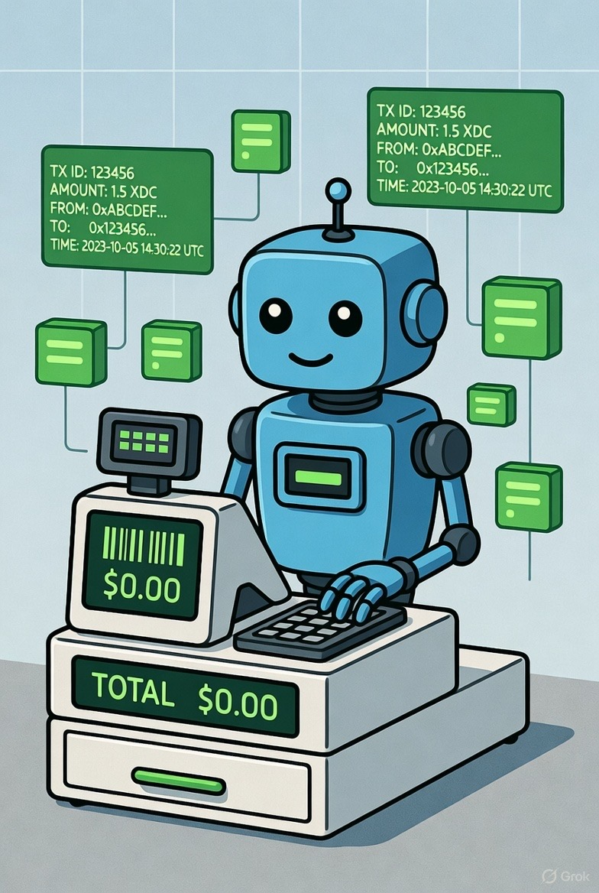

# XDC Proof: PDF payment receipts for XDC transactions

Turn any XDC Network payment into a PDF receipt with a QR code that links to the transaction on XDCScan, so anyone can verify it. Make one at a time or a whole batch, for invoices, bookkeeping or trade finance.

**[Open XDC Proof →](https://xdcoutpost.xyz/XDC_Proof/?utm_source=github)**

Part of [XDC Outpost](https://xdcoutpost.xyz/?utm_source=github-proof) · Free, runs in your browser · ⭐ Star the repo if it helps you.



## Features

- **Receipts for confirmed payments only.** Failed or still-pending transactions are refused, so a receipt never shows a payment that didn't happen.
- **XDC and token payments.** For XRC-20 tokens (for example USDT or AUDD), the receipt shows the token amount and the real recipient, not the token contract.
- **Verifiable.** Each receipt shows the date, both addresses, the exact amount, network fee, block number and network, plus a QR code to the transaction on XDCScan (or the testnet explorer for testnet transactions).
- **Any language.** Names, addresses and descriptions can be in any language, including Chinese, Japanese, Korean, Arabic, Hebrew, Hindi and Thai.
- **Address book.** Save the names and details behind addresses you deal with often, and receipts fill them in automatically.
- **Batch receipts.** Upload a list of transactions and get every receipt in one ZIP, with a summary of what was created.
- **Private.** Receipts are created on your device. The only thing sent anywhere is the transaction lookup to the XDC RPC.

## Create a single receipt

1. **Paste the transaction hash** (0x followed by 64 characters). The page looks it up straight away and shows the amount, date, both parties, fee and block, so you can check it's the right payment.
2. **Describe what the payment was for**, for example "Invoice #456: 500 widgets". This is printed on the receipt.
3. **Optional: add seller and purchaser details.** The seller received the payment; the purchaser sent it. Details from your address book fill in automatically and are highlighted, and you can edit them.
4. **Optional: add a seller logo URL**, ideally a square PNG or JPG. If the image host blocks it, the receipt is made without the logo and you're told why.
5. Click **Download PDF receipt**.

For testnet transactions, open **Network settings** and enter an Apothem RPC.

## Address book

Save the real-world details behind addresses you deal with often. Whenever a receipt involves one of those addresses, the details fill in automatically. (Earlier versions called this "Bulk Entity Mapping"; saved data carries over.)

1. Click **Download sample CSV**, edit it in a spreadsheet or text editor, and save it as CSV.
2. Click **Upload CSV**, or **Paste CSV** to paste the text.
3. The page shows how many addresses were saved and lists them. Rows without a valid address are skipped and listed.

It's stored only in this browser until you click **Clear address book**.

```csv
"address","name","company","address_line","phone","email","logo_url"
"xdc1a2b3c4d5e6f7a8b9c0d1e2f3a4b5c6d7e8f9a0b","Acme Corp","Acme Corporation","123 Main St, Suite 100, New York, NY 10001","555-1000","acme@corp.com","https://example.com/acme.png"
```

- `address`: the wallet address (xdc… or 0x…)
- `name`: shown on receipts (`company` is used if `name` is empty)
- `address_line`, `phone`, `email`: printed under the name
- `logo_url`: used as the seller's logo, ideally a square PNG of at least 400×400 px

Put every value in double quotes so commas inside addresses don't break the row. Files saved from Excel work too.

## Batch receipts

1. Click **Download sample CSV** in the Batch section, and replace the example rows with your own transaction hashes and descriptions.
2. Click **Upload batch CSV**. The page shows how many rows are ready and lists any it skipped (invalid hash, no description, duplicates).
3. Click **Create receipts**. A progress bar shows how far it's got, and you can cancel.
4. You get a ZIP with one PDF per transaction and a **summary.csv** listing every row and what happened to it.

Names come from your address book. Failed or unconfirmed transactions are left out and listed in the summary.

```csv
"tx_hash","description"
"0x7f8c9d2b1a3e4f5c6d7b8a9e0f1c2d3b4e5a6f7c8d9e0a1b2c3d4e5f6a7b8c9","Invoice #501: 500 Widgets"
```

## What a receipt proves

The amount, date, addresses, block and status come straight from the blockchain, and the QR code lets anyone check them on XDCScan. Names, contact details and the description are what you enter, so they're only as reliable as their source.

## How it's built

Plain HTML and JavaScript. The PDF ([jsPDF](https://github.com/parallax/jsPDF) 2.5.1), QR code ([qrcode](https://github.com/soldair/node-qrcode) 1.5.0) and ZIP ([JSZip](https://github.com/Stuk/jszip) 3.10.1) libraries are stored in this repo at fixed versions (`vendor/`), not loaded from CDNs. Non-Latin text uses embedded [Noto](https://fonts.google.com/noto) fonts (SIL Open Font License, `vendor/fonts/`), downloaded only when needed. Amounts are calculated exactly, with no rounding.

## Contact

Questions, a receipt that looks wrong, or a feature you need for your accounts? Open a [GitHub issue](https://github.com/s4njk4n/XDC_Proof/issues), or message me on [Telegram](https://t.me/s4njk4n), Discord (@s4njk4n) or [X](https://x.com/s4njk4n).

[MIT License](LICENSE). Provided as-is, without warranty. Receipts reflect on-chain data and the details you enter; check them before relying on them for tax or legal purposes.
